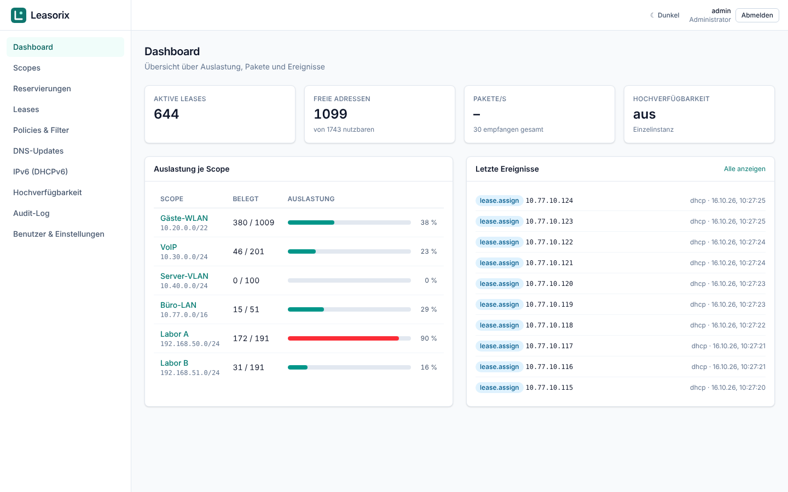
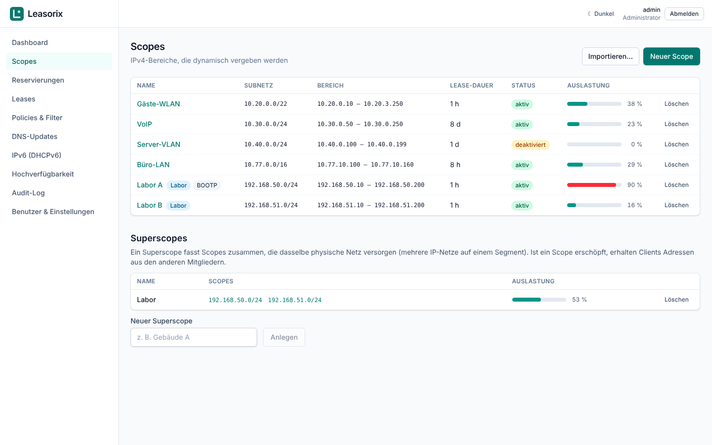
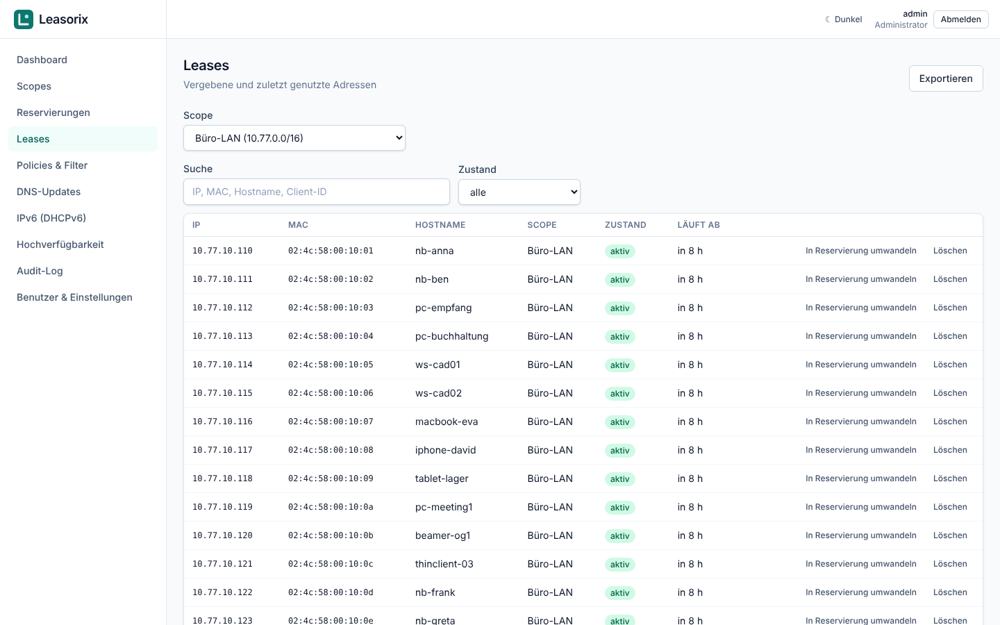
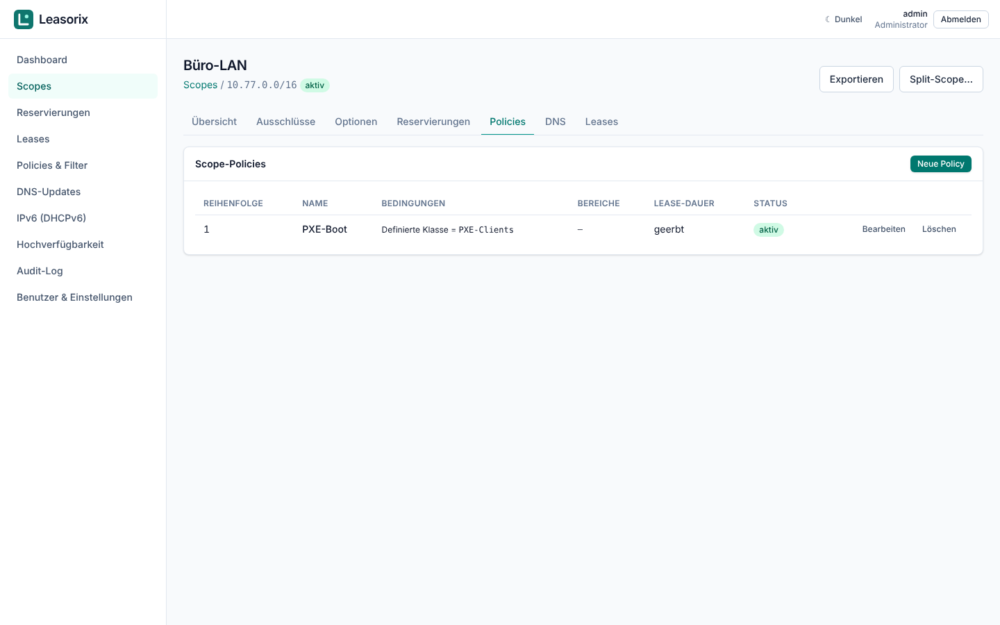
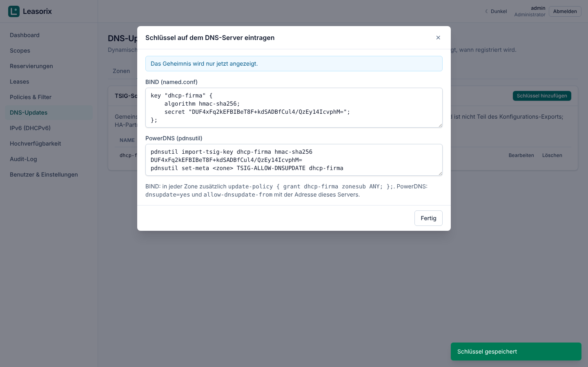
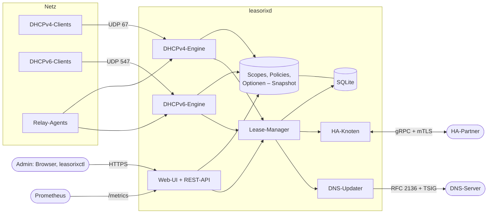

# Leasorix

[](https://github.com/meister119/leasorix/actions/workflows/ci.yml)

Selbst gehosteter DHCP-Server mit dem Funktionsumfang eines Windows-DHCP-Servers:
Scopes, Reservierungen, Optionen, Policies und Failover – dazu eine moderne
Web-UI, REST-API, DNS-Updates, DHCPv6 und ein fertiges Docker/Compose-Deployment.
Ein einziges Binary mit eingebetteter UI und SQLite, keine externe Datenbank.

<picture>
  <source media="(prefers-color-scheme: dark)" srcset="docs/images/dashboard-dark.png">
  
</picture>

> Status: alle Phasen aus [PLAN.md](PLAN.md) umgesetzt (inkl. optionalem DHCPv6) – siehe [docs/PROGRESS.md](docs/PROGRESS.md).

## Funktionen

### DHCPv4
- Vollständiger DHCP-Ablauf nach RFC 2131/2132 (DISCOVER/OFFER/REQUEST/ACK, RENEW, REBIND, INIT-REBOOT, RELEASE, DECLINE, INFORM)
- **Scopes** mit Bereich, Ausschlüssen, Lease-Dauer und Aktiv-Schalter; **Superscopes** für mehrere IP-Netze auf einem Segment
- **Reservierungen** per MAC oder Client-ID, CSV-Import, „Lease in Reservierung umwandeln“
- **Relay-Unterstützung** (giaddr, Option 82, Option 118 / 82.5) für entfernte Netze
- **Konflikterkennung** per ICMP vor jeder neuen Adresse, BOOTP (reserviert und dynamisch)

### Optionen, Klassen & Policies
- Optionskatalog mit typisierten Werten und eigenen Optionsdefinitionen; Vererbung Server → Scope → Policy → Reservierung
- **Vendor-/User-Klassen** und **Policies** wie unter Windows: Bedingungen auf MAC, Client-ID, Hostname, Vendor-/User-Class oder Option 82 – mit eigenen Optionen, Lease-Dauer und Adressbereichen
- **MAC-Filter** (Allow-/Deny-Liste mit Platzhaltern)

### Hochverfügbarkeit
- Zwei Server als Partner im **Load-Balance-** oder **Hot-Standby-Modus**
- Synchrone Lease-Replikation über **gRPC mit mTLS**, Zustandsautomat mit automatischem Abgleich nach Ausfall oder Netztrennung
- Konfiguration wird vom Config-Leader repliziert, der Partner ist in der UI schreibgeschützt
- *Partner Down* per Knopfdruck, Split-Scope-Assistent als Fallback ohne Replikation

### DNS-Updates
- Dynamische A- und PTR-Records nach **RFC 2136** mit **TSIG** (BIND, PowerDNS; Windows-DNS unsigniert)
- Pro Scope: nie, auf Anforderung des Clients (Option 81) oder immer; Namensschutz per **DHCID** (RFC 4701/4703)
- Automatisches Aufräumen beim Lease-Ende, Registrierungsstatus in der UI

### DHCPv6
- Stateful DHCPv6 nach **RFC 8415**: Adressen (IA_NA) und **Präfix-Delegation** (IA_PD) für Router
- Reservierungen per DUID/IAID, Optionen (DNS, Suchliste, NTP …), Rapid Commit, Server-Präferenz, Relays

### Verwaltung & Betrieb
- **Web-UI** (hell/dunkel) mit Assistenten, Live-Auslastung und Lease-Suche
- **REST-API** mit OpenAPI-Spezifikation und die Kommandozeile **`leasorixctl`**
- Rollen (Admin, Operator, Nur lesen), API-Tokens, Login-Sperre, CSRF-Schutz, HTTPS
- **Audit-Log** mit Vorher/Nachher, **Prometheus-Metriken**, Health-Checks
- **Umzug von Windows:** `netsh dhcp server dump` importieren; Konfiguration als YAML/JSON exportieren und importieren
- **Backup/Restore** im laufenden Betrieb, Lease-Notfall-Export

### Deployment
- Statisches Go-Binary, SQLite (WAL), keine weiteren Abhängigkeiten
- Distroless-**Docker-Image** als Nicht-root-Benutzer mit File-Capabilities
- Compose-Varianten für Host-Netzwerk, macvlan und ein HA-Paar

## Screenshots

<table>
  <tr>
    <td width="50%"><b>Scopes</b> – Übersicht mit Auslastung, Superscopes und BOOTP<br></td>
    <td width="50%"><b>Scope</b> – Statistik und Einstellungen eines Scopes<br></td>
  </tr>
  <tr>
    <td><b>Leases</b> – vergebene Adressen mit Suche und Aktionen<br></td>
    <td><b>Policies</b> – Optionen für PXE-Clients per Vendor-Klasse<br></td>
  </tr>
  <tr>
    <td><b>DNS-Updates</b> – TSIG-Schlüssel mit fertiger Konfiguration für BIND und PowerDNS<br></td>
    <td><b>DHCPv6</b> – IPv6-Scope mit Präfix-Delegation<br></td>
  </tr>
</table>

Die Bilder entstehen automatisch aus Demo-Daten mit echten DHCP-Clients:
`make screenshots` (root, wie `make test-e2e`).

## Architektur



Mehr dazu in [docs/ARCHITECTURE.md](docs/ARCHITECTURE.md).

## Schnellstart mit Docker Compose

DHCP braucht Layer-2-Zugang zum LAN, deshalb läuft der Container im
Host-Netzwerk (oder mit eigener Adresse per macvlan – ein Bridge-Netz ohne
Relay funktioniert nicht):

```sh
git clone https://github.com/meister119/leasorix && cd leasorix/deploy
export LEASORIX_DHCP4_INTERFACES=eth0             # LAN-Interface des Hosts
export LEASORIX_HTTP_LISTEN=192.168.1.10:8067     # Adresse für die Web-UI
docker compose up -d                              # Image: ghcr.io/meister119/leasorix
docker compose logs leasorix | grep setup_token   # einmaliges Setup-Token
```

`https://192.168.1.10:8067/` öffnen, mit dem Token den ersten Administrator
anlegen, Scope einrichten – fertig. Lokal gebautes Image statt Registry:
`make docker` und `LEASORIX_IMAGE=leasorix:latest docker compose up -d`.

| Compose-Datei | Variante |
|---|---|
| `deploy/docker-compose.yml` | ein Server, Host-Netzwerk |
| `deploy/docker-compose.macvlan.yml` | ein Server mit eigener IP im LAN |
| `deploy/docker-compose.ha.yml` | HA-Paar (zwei Container, mTLS-Zertifikate automatisch) |

Details, Rechte, macvlan-Besonderheiten und Fehlersuche:
[docs/DOCKER.md](docs/DOCKER.md).

## Bauen

Voraussetzungen: Go ≥ 1.26 (die Toolchain wird über `go.mod` automatisch
geladen), Node.js ≥ 22 für die Web-UI, optional `golangci-lint` v2 und
`govulncheck`.

```sh
make build        # Web-UI bauen + bin/leasorixd mit eingebetteter UI
make build-noui   # nur das Binary (ohne Node.js), UI zeigt einen Hinweis
make test         # Go-Unit-Tests mit Race-Detector
make ui-test      # Frontend: Typecheck + Vitest
make lint         # golangci-lint
make test-integration  # DHCP-Ende-zu-Ende in Network Namespaces (root)
make test-ha      # Zwei-Knoten-HA-Tests (5000 Clients, Failover, Partition; root)
make test-dns     # DNS-Updates gegen BIND und PowerDNS (root, Docker)
make test-e2e     # Playwright gegen die echte UI + echten DHCP-Client (root)
make screenshots  # README-Screenshots neu erzeugen (root)
make docker       # Container-Image leasorix:<version> und :latest
make test-docker  # Image + Compose-Dateien (host, macvlan, HA) testen (root)
make generate     # API- und Peer-Protokoll-Code neu erzeugen (protoc 3.21)
make ci           # lint + test + ui-test + build + vuln
```

## Starten

```sh
./bin/leasorixd --config deploy/examples/leasorix.yml
```

Jeder Config-Wert lässt sich per Umgebungsvariable überschreiben, z. B.
`LEASORIX_HTTP_LISTEN=10.0.0.5:8067`, `LEASORIX_DHCP4_INTERFACES=eth0` oder
`LEASORIX_DHCP6_INTERFACES=eth0` (DHCPv6 einschalten).

Beim ersten Start steht im Log ein einmaliges Setup-Token
(`setup_token=…`). Damit legt man unter `https://127.0.0.1:8067/` den ersten
Administrator an (das Zertifikat ist anfangs selbstsigniert).

Endpunkte des Management-Listeners (Default `https://127.0.0.1:8067`):

| Pfad | Zweck |
|---|---|
| `/healthz` | Liveness |
| `/readyz` | Readiness (Datenbank, DHCP-Listener) |
| `/metrics` | Prometheus-Metriken |
| `/api/v1` | REST-API (Spec: `internal/api/openapi.yaml`) |
| `/` | Web-UI |

## Verwaltung per Kommandozeile

`make build` erzeugt zusätzlich `bin/leasorixctl`, das den Server über die
REST-API steuert (API-Token unter *Benutzer & Einstellungen* anlegen):

```sh
export LEASORIX_URL=https://127.0.0.1:8067 LEASORIX_TOKEN=lxt_… LEASORIX_INSECURE=1
leasorixctl status
leasorixctl scopes list
leasorixctl leases list --scope LAN -q printer
leasorixctl v6 leases                                     # DHCPv6-Bindungen
leasorixctl config export -f config.yaml
leasorixctl config import --netsh dhcp-dump.txt --dry-run   # Umzug von Windows
```

Offline-Kommandos des Servers (HA-Zertifikate, Notfall und Sicherung):

```sh
leasorixd ha certs --out ./ha-certs dhcp-a dhcp-b      # mTLS-Zertifikate erzeugen
leasorixd leases export --config … --out leases.json   # Notfall-Export
leasorixd leases import --config … leases.json         # Import (Dienst gestoppt)
leasorixd backup --config … --out backup.db            # Backup (auch im Betrieb)
leasorixd restore --config … backup.db                 # Restore (Dienst gestoppt)
```

## Dokumentation

| Dokument | Inhalt |
|---|---|
| [docs/ADMIN.md](docs/ADMIN.md) | Admin-Handbuch: Scopes, Optionen, Policies, Rollen, Export/Import, Umzug von Windows, DNS-Updates, DHCPv6 |
| [docs/HA.md](docs/HA.md) | Hochverfügbarkeit einrichten und betreiben |
| [docs/DOCKER.md](docs/DOCKER.md) | Docker, Compose, Netzwerk-Hinweise |
| [docs/ARCHITECTURE.md](docs/ARCHITECTURE.md) | Aufbau und Datenflüsse |
| [docs/DECISIONS.md](docs/DECISIONS.md) | Entscheidungen und ihre Begründung |
| [docs/PROGRESS.md](docs/PROGRESS.md) | Fortschritt je Phase |
