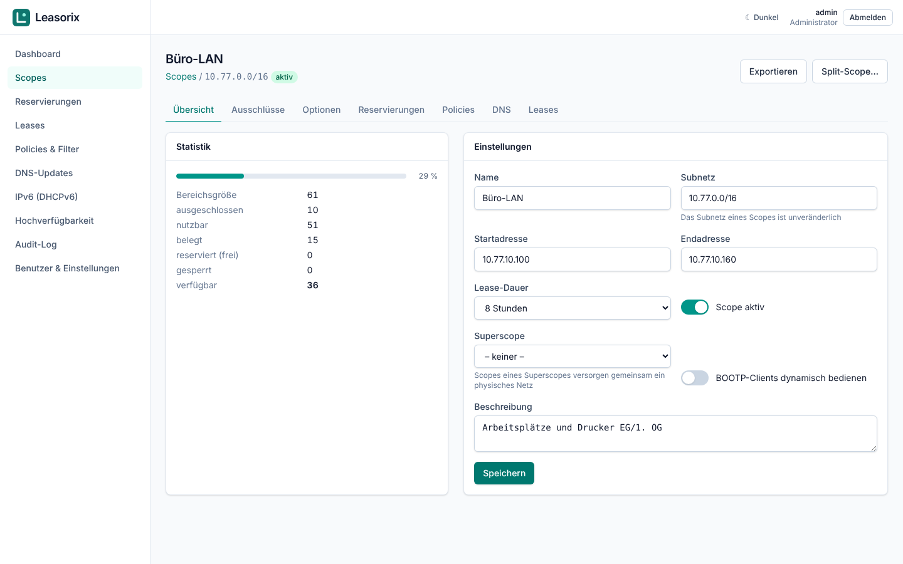
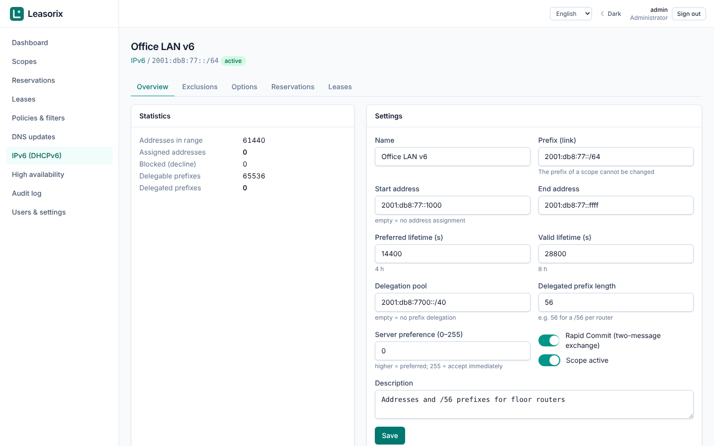
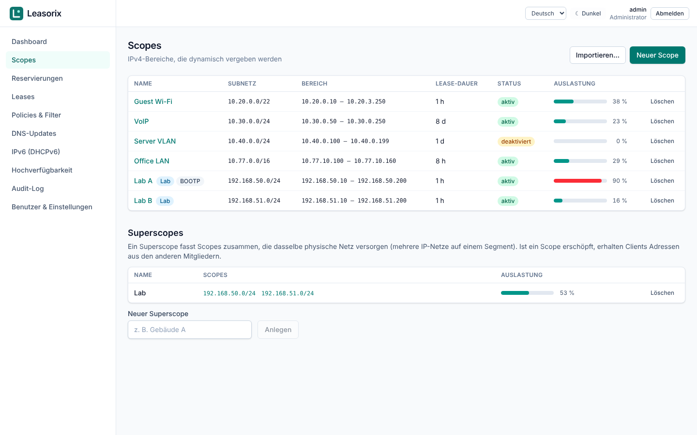
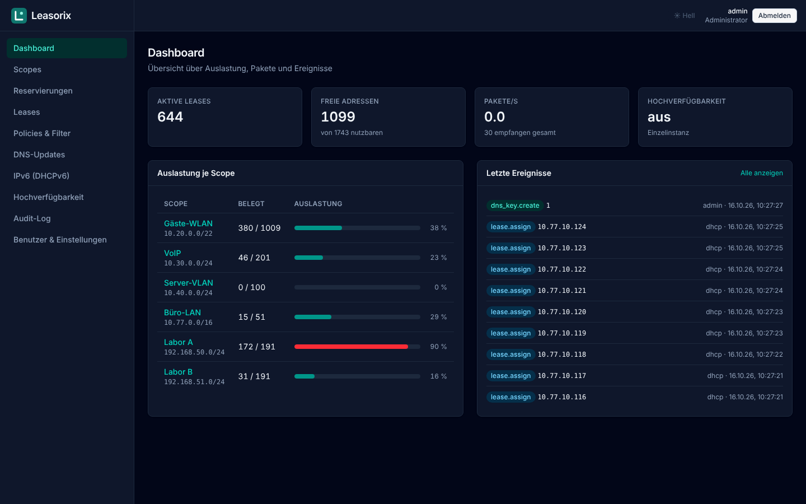
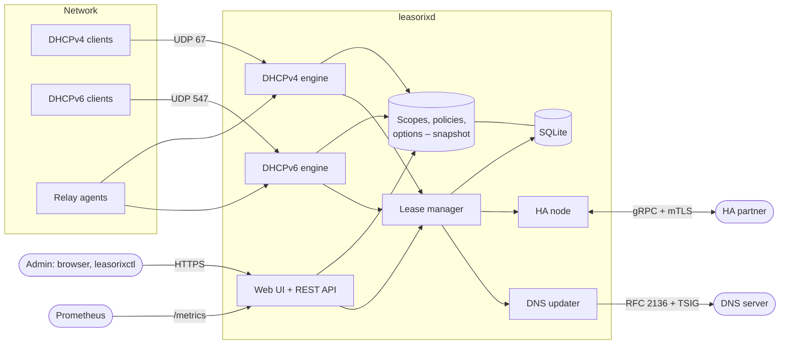

# Leasorix

[](https://github.com/meister119/leasorix/actions/workflows/ci.yml)
[](LICENSE)

**The features of a Windows DHCP server – without Windows.**

Leasorix is a self-hosted DHCP server for Linux and Docker: scopes,
reservations, options, policies and failover like on Windows Server, with a
modern web UI, a REST API, dynamic DNS updates and DHCPv6. One single binary
with the UI embedded and SQLite inside – no external database, no config
files to hand-edit. Moving from Windows? Import your existing setup from a
`netsh` export.

> **Status: beta – testers wanted.** All features are implemented and
> covered by automated tests, but Leasorix has seen little production use
> so far. Please try it in a lab or test network first, and
> [tell us how it went](https://github.com/meister119/leasorix/issues/new/choose).

<picture>
  <source media="(prefers-color-scheme: dark)" srcset="docs/images/dashboard-dark.png">
  
</picture>

## Quick start

Every release is published ready to run – nothing to build on the server:
a multi-arch **Docker image** (`ghcr.io/meister119/leasorix`, linux/amd64
and arm64) and **binaries** with a systemd unit on the
[releases page](https://github.com/meister119/leasorix/releases).

DHCP needs layer 2 access to the LAN, so the container runs in the host
network (or with its own address via macvlan – a bridge network without a
relay does not work):

```sh
mkdir leasorix && cd leasorix
curl -fsSLO https://github.com/meister119/leasorix/releases/latest/download/docker-compose.yml
cat > .env <<'EOF'
LEASORIX_DHCP4_INTERFACES=eth0           # interface(s) to serve DHCP on
LEASORIX_HTTP_LISTEN=192.168.1.10:8067   # management address of this host
EOF
docker compose up -d                               # pulls the image, no build
docker compose logs leasorix | grep setup_token    # one-time setup token
```

Open `https://192.168.1.10:8067/`, create the first administrator with the
token, set up a scope – done. Or just the image:
`docker pull ghcr.io/meister119/leasorix:latest`.

| Compose file (release asset, also in `deploy/`) | Variant |
|---|---|
| `docker-compose.yml` | one server, host network |
| `docker-compose.macvlan.yml` | one server with its own IP in the LAN |
| `docker-compose.ha.yml` | HA pair (two containers, mTLS certificates created automatically) |

Image tags, binaries with systemd, updates and access to a private
repository: [docs/INSTALL.md](docs/INSTALL.md). Permissions, macvlan
specifics and troubleshooting: [docs/DOCKER.md](docs/DOCKER.md). To use a
locally built image instead: `make docker` and
`LEASORIX_IMAGE=leasorix:latest docker compose -f deploy/docker-compose.yml up -d`.

## Why Leasorix?

| | Leasorix | Windows DHCP | ISC dhcpd | Kea |
|---|---|---|---|---|
| Runs on Linux / in Docker | ✅ | ❌ | ✅ | ✅ |
| Web UI for configuration | ✅ built in | MMC (Windows only) | ❌ | via Stork (separate) |
| Failover with two servers | ✅ | ✅ | ✅ | ✅ (HA hook) |
| Windows-style policies and classes | ✅ | ✅ | classes | client classes |
| Import from Windows DHCP (`netsh`) | ✅ | – | ❌ | ❌ |
| REST API, audit log, roles | ✅ | PowerShell | ❌ | REST API |
| Actively maintained | ✅ | ✅ | ❌ end of life since 2022 | ✅ |

## Features

### DHCPv4
- Complete DHCP protocol after RFC 2131/2132 (DISCOVER/OFFER/REQUEST/ACK, RENEW, REBIND, INIT-REBOOT, RELEASE, DECLINE, INFORM)
- **Scopes** with range, exclusions, lease duration and an on/off switch; **superscopes** for several IP networks on one segment
- **Reservations** by MAC address or client ID, CSV import, “convert lease to reservation”
- **Relay support** (giaddr, option 82, option 118 / 82.5) for remote networks
- **Conflict detection** by ICMP before every new address, BOOTP (reserved and dynamic)

### Options, classes & policies
- Option catalog with typed values and custom option definitions; inheritance server → scope → policy → reservation
- **Vendor/user classes** and **policies** like on Windows: conditions on MAC, client ID, host name, vendor/user class or option 82 – with their own options, lease duration and address ranges
- **MAC filters** (allow and deny list with wildcards)

### High availability
- Two servers as partners in **load balance** or **hot standby** mode
- Synchronous lease replication over **gRPC with mTLS**, state machine with automatic resynchronization after an outage or a network split
- The configuration is replicated from the config leader; the partner is read-only in the UI
- *Partner down* with one click, split scope wizard as a fallback without replication

### DNS updates
- Dynamic A and PTR records after **RFC 2136** with **TSIG** (BIND, PowerDNS; Windows DNS unsigned)
- Per scope: never, on client request (option 81) or always; name protection with **DHCID** (RFC 4701/4703)
- Records are removed when the lease ends; registration status in the UI

### DHCPv6
- Stateful DHCPv6 after **RFC 8415**: addresses (IA_NA) and **prefix delegation** (IA_PD) for routers
- Reservations by DUID/IAID, options (DNS, search list, NTP …), rapid commit, server preference, relays

### Administration & operation
- **Web UI** in **English and German** (switch in the header), light and dark mode, wizards, live utilization and lease search
- **REST API** with an OpenAPI specification and the command line tool **`leasorixctl`**
- Roles (administrator, operator, read-only), API tokens, login throttling, CSRF protection, HTTPS
- **Audit log** with before/after values, **Prometheus metrics**, health checks
- **Migration from Windows:** import a `netsh dhcp server dump`; export and import the configuration as YAML/JSON
- **Backup/restore** while running, emergency lease export

### Deployment
- **Ready-made releases:** multi-arch image `ghcr.io/meister119/leasorix` (amd64, arm64) and binaries with a systemd unit – nothing to build on the server
- Static Go binary, SQLite (WAL), no further dependencies
- Distroless **Docker image** running as non-root with file capabilities
- Compose variants for host networking, macvlan and an HA pair

## Screenshots

<table>
  <tr>
    <td width="50%"><b>Scopes</b> – overview with utilization, superscopes and BOOTP<br></td>
    <td width="50%"><b>Scope</b> – statistics and settings of one scope<br></td>
  </tr>
  <tr>
    <td><b>Leases</b> – assigned addresses with search and actions<br></td>
    <td><b>Policies</b> – options for PXE clients by vendor class<br></td>
  </tr>
  <tr>
    <td><b>DNS updates</b> – TSIG key with ready-made configuration for BIND and PowerDNS<br></td>
    <td><b>DHCPv6</b> – IPv6 scope with prefix delegation<br></td>
  </tr>
  <tr>
    <td><b>Deutsch</b> – the whole UI is also available in German<br></td>
    <td><b>Dark mode</b><br></td>
  </tr>
</table>

The screenshots are generated from demo data with real DHCP clients:
`make screenshots` (as root, like `make test-e2e`).

## Architecture



More in [docs/ARCHITECTURE.md](docs/ARCHITECTURE.md).

## Building

Requirements: Go ≥ 1.26 (the toolchain is fetched automatically via
`go.mod`), Node.js ≥ 22 for the web UI, optionally `golangci-lint` v2 and
`govulncheck`.

```sh
make build        # build the web UI + bin/leasorixd with the UI embedded
make build-noui   # binary only (no Node.js); the UI shows a notice
make test         # Go unit tests with the race detector
make ui-test      # frontend: type check + Vitest
make lint         # golangci-lint
make test-integration  # DHCP end to end in network namespaces (root)
make test-ha      # two-node HA tests (5000 clients, failover, partition; root)
make test-dns     # DNS updates against BIND and PowerDNS (root, Docker)
make test-e2e     # Playwright against the real UI + a real DHCP client (root)
make screenshots  # regenerate the README screenshots (root)
make docker       # container image leasorix:<version> and :latest
make ui dist      # release files in dist/: binaries for amd64/arm64, Compose files, SHA256SUMS
make test-docker  # test the image and the Compose files (host, macvlan, HA; root)
make generate     # regenerate API and peer protocol code (protoc 3.21)
make ci           # lint + test + ui-test + build + vuln
```

## Running

```sh
./bin/leasorixd --config deploy/examples/leasorix.yml
```

Every config value can be overridden by an environment variable, e.g.
`LEASORIX_HTTP_LISTEN=10.0.0.5:8067`, `LEASORIX_DHCP4_INTERFACES=eth0` or
`LEASORIX_DHCP6_INTERFACES=eth0` (enables DHCPv6).

On the first start the log contains a one-time setup token
(`setup_token=…`). Use it at `https://127.0.0.1:8067/` to create the first
administrator (the certificate is self-signed at first).

Endpoints of the management listener (default `https://127.0.0.1:8067`):

| Path | Purpose |
|---|---|
| `/healthz` | liveness |
| `/readyz` | readiness (database, DHCP listeners) |
| `/metrics` | Prometheus metrics |
| `/api/v1` | REST API (spec: `internal/api/openapi.yaml`) |
| `/` | web UI |

## Command line

`make build` also produces `bin/leasorixctl`, which controls the server over
the REST API (create an API token under *Users & settings*):

```sh
export LEASORIX_URL=https://127.0.0.1:8067 LEASORIX_TOKEN=lxt_… LEASORIX_INSECURE=1
leasorixctl status
leasorixctl scopes list
leasorixctl leases list --scope LAN -q printer
leasorixctl v6 leases                                     # DHCPv6 bindings
leasorixctl config export -f config.yaml
leasorixctl config import --netsh dhcp-dump.txt --dry-run   # migration from Windows
```

Offline commands of the server (HA certificates, emergency and backup):

```sh
leasorixd ha certs --out ./ha-certs dhcp-a dhcp-b      # create mTLS certificates
leasorixd leases export --config … --out leases.json   # emergency export
leasorixd leases import --config … leases.json         # import (service stopped)
leasorixd backup --config … --out backup.db            # backup (also while running)
leasorixd restore --config … backup.db                 # restore (service stopped)
```

## Documentation

| Document | Contents |
|---|---|
| [docs/INSTALL.md](docs/INSTALL.md) | Installation from a release (Docker, binaries with systemd), updates, image tags, publishing a release |
| [docs/ADMIN.md](docs/ADMIN.md) | Administrator guide: scopes, options, policies, roles, export/import, migration from Windows, DNS updates, DHCPv6 |
| [docs/HA.md](docs/HA.md) | Setting up and running high availability |
| [docs/DOCKER.md](docs/DOCKER.md) | Docker, Compose, network notes |
| [docs/ARCHITECTURE.md](docs/ARCHITECTURE.md) | Structure and data flows |

## Contributing

Bug reports, test results and pull requests are welcome – see
[CONTRIBUTING.md](CONTRIBUTING.md). Please report security problems
privately as described in [SECURITY.md](SECURITY.md).

## License

Leasorix is free software under the [GNU Affero General Public License v3.0](LICENSE).
You may use, modify and redistribute it; if you offer a modified version
to others over a network, you must make its source code available to them
as well.
